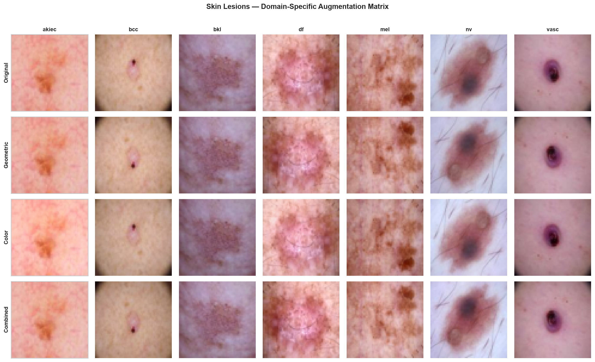
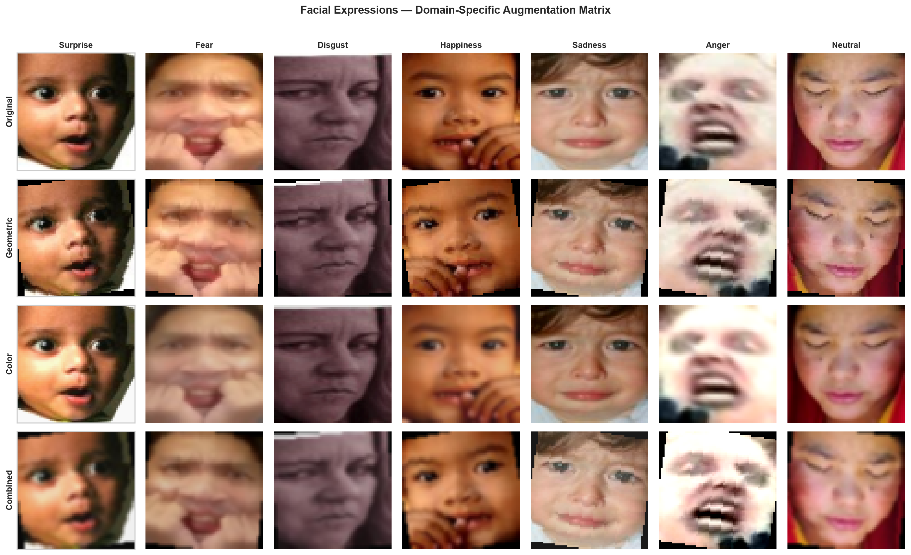
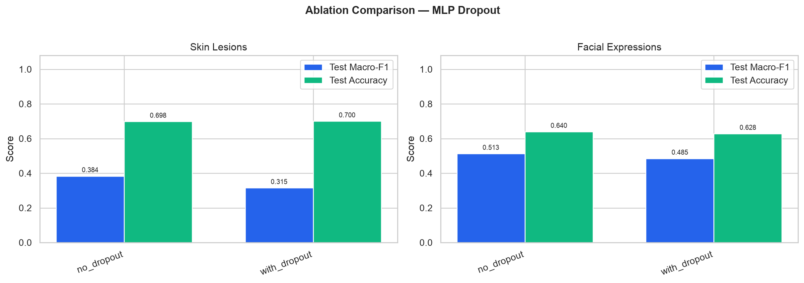
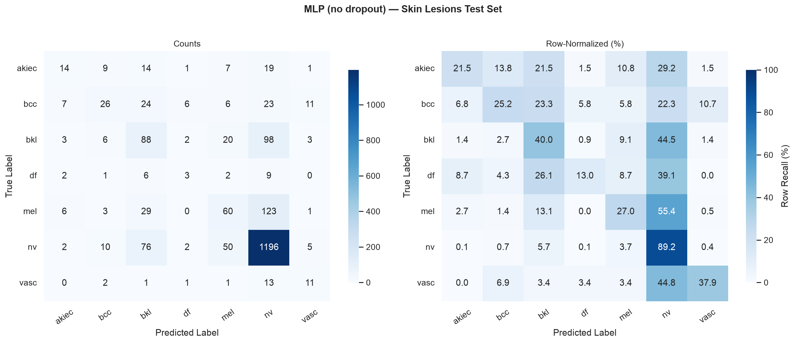
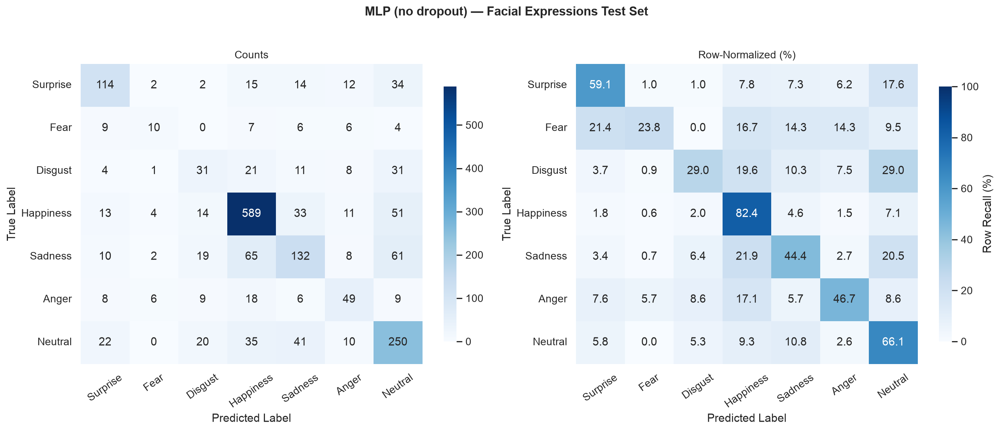
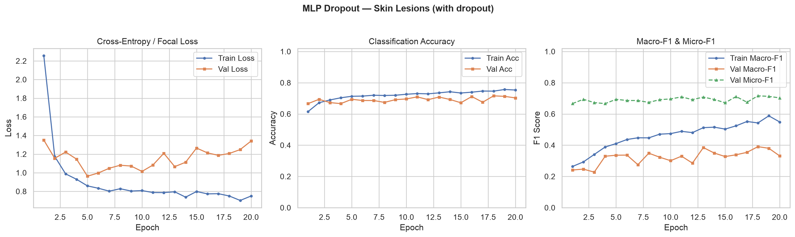
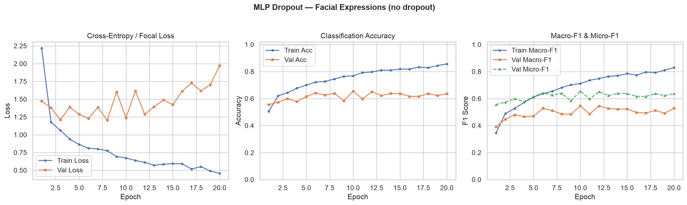

# Imbalance-Aware Vision Classification

Controlled ablation study of multi-class image classification under severe class imbalance across two domains: dermatoscopic skin lesions (7 classes, 58.3:1 class ratio) and in-the-wild facial expressions (7 classes, 17.0:1 class ratio).

The codebase evaluates MLPs, 4-layer custom CNNs, and fine-tuned ResNet-18 models across regularization, normalization, domain-specific data augmentation, class-imbalance mitigation (`WeightedRandomSampler`, inverse-frequency cross-entropy, `FocalLoss`), learning rate schedules, and self-paced curriculum learning.

## Datasets

| Domain | Dataset Key | Input Size | Train / Val / Held-Out Test | Unlabeled Inference | Max : Min Class Ratio |
| :--- | :--- | :---: | :---: | :---: | :---: |
| Skin lesions (dermatoscopy) | `skin_lesions` | `130x100` RGB | `5,107` / `902` / `2,003` | `2,003` | `58.3 : 1` (`nv` 4,023 vs. `df` 69) |
| Facial expressions (wild) | `facial_expressions` | `100x100` RGB | `8,868` / `1,566` / `1,837` | `3,068` | `17.0 : 1` (`Happiness` 4,057 vs. `Fear` 239) |

Validation sets are generated with a deterministic 85/15 stratified split (`seed=42`) from each training manifest. Checkpoints are selected strictly by validation Macro-F1, and held-out test splits are evaluated once after training finishes.

<details>
<summary>Class counts across splits</summary>

Skin lesions (`skin_lesions`):
- `akiec` (actinic keratoses / Bowen's disease): 196 train+val / 65 test
- `bcc` (basal cell carcinoma): 308 train+val / 103 test
- `bkl` (benign keratosis): 660 train+val / 220 test
- `df` (dermatofibroma): 69 train+val / 23 test
- `mel` (melanoma): 668 train+val / 222 test
- `nv` (melanocytic nevi): 4,023 train+val / 1,341 test
- `vasc` (vascular lesions): 85 train+val / 29 test

Facial expressions (`facial_expressions`):
- `1` Surprise: 1,097 train+val / 193 test
- `2` Fear: 239 train+val / 42 test
- `3` Disgust: 610 train+val / 107 test
- `4` Happiness: 4,057 train+val / 715 test
- `5` Sadness: 1,685 train+val / 297 test
- `6` Anger: 600 train+val / 105 test
- `7` Neutral: 2,146 train+val / 378 test

</details>

## Project Layout

```text
.
├── configs/
│   ├── ablations.yaml
│   ├── datasets/
│   │   ├── facial_expressions.yaml
│   │   └── skin_lesions.yaml
│   └── experiments/
│       ├── cnn_baseline.yaml
│       ├── mlp_baseline.yaml
│       └── resnet18_finetune.yaml
├── src/
│   ├── datasets.py       # CSV manifests, stratified splits, weighted sampler DataLoaders
│   ├── transforms.py     # Domain augmentations and dataset / ImageNet normalization
│   ├── models.py         # SimpleMLP, SimpleCNN, ResNet-18, freeze_bn, differential LRs
│   ├── losses.py         # Class-weighted CrossEntropyLoss and FocalLoss
│   ├── metrics.py        # Accuracy, Macro/Micro/Weighted F1, confusion matrices, plots
│   ├── trainer.py        # Training loop, LR warmup/cosine, self-paced curriculum, TensorBoard
│   └── utils.py          # Seeding, YAML loading with env interpolation, logging
├── scripts/
│   ├── train.py          # Train a single experiment
│   ├── run_ablations.py  # Run ablation suites and export CSV/JSON/plots
│   ├── evaluate.py       # Evaluate a saved checkpoint on val or held-out test
│   └── predict.py        # Export predictions CSV on unlabeled test manifests
├── tests/                # Pytest suite (15 tests)
├── results/              # Logged CSV/JSON summaries
├── assets/               # Augmentation grids, learning curves, confusion matrices
├── pyproject.toml
└── requirements.txt
```

## Setup

```bash
git clone https://github.com/stoichy/CNN-classification.git
cd CNN-classification

python3 -m venv .venv
source .venv/bin/activate
pip install -r requirements.txt
```

Raw image archives and model checkpoints are ignored by `.gitignore`. Place or symlink the extracted datasets under `data/`, or pass paths via environment variables or CLI flags:

```bash
mkdir -p data
ln -s /path/to/skin-lesions data/skin_lesions
ln -s /path/to/facial-expressions data/facial_expressions

# Alternatively:
export SKIN_DATA_ROOT=/path/to/skin-lesions
export EXPRESSIONS_DATA_ROOT=/path/to/facial-expressions
```

Run the test suite:

```bash
pytest -v
```

## Usage

Train a single configuration:

```bash
python scripts/train.py \
  --dataset-config configs/datasets/skin_lesions.yaml \
  --config configs/experiments/resnet18_finetune.yaml \
  --export-plots
```

Train a CNN with focal loss and self-paced curriculum learning:

```bash
python scripts/train.py \
  --dataset-config configs/datasets/skin_lesions.yaml \
  --config configs/experiments/cnn_baseline.yaml \
  --aug-mode combined \
  --imbalance-mode focal \
  --curriculum \
  --export-plots
```

Run the full ablation matrix (recommended on GPU, e.g. Colab T4):

```bash
python scripts/run_ablations.py --config configs/ablations.yaml

# Or run the CNN and ResNet-18 suites directly:
python scripts/run_ablations.py \
  --config configs/ablations.yaml \
  --suites cnn_batchnorm augmentation imbalance resnet_warmup curriculum
```

Evaluate a saved checkpoint and generate test predictions:

```bash
python scripts/evaluate.py \
  --checkpoint outputs/mlp_dropout_skin_lesions_no_dropout/best_model.pt \
  --split test \
  --output-cm assets/eval_skin_cm.png

python scripts/predict.py \
  --checkpoint outputs/mlp_dropout_skin_lesions_no_dropout/best_model.pt \
  --output-csv submission_skin.csv
```

Monitor runs in TensorBoard:

```bash
tensorboard --logdir runs
```

## Augmentation Design

Augmentations are chosen per domain so label semantics remain intact:

- Skin lesions (`skin_lesions`): Dermatoscopic captures have no fixed orientation, so geometric transforms apply horizontal and vertical flips (`p=0.5`). Color jitter is kept conservative (`brightness=0.1, contrast=0.1`, no hue or saturation shifts) because lesion pigmentation carries diagnostic signal.
- Facial expressions (`facial_expressions`): Faces are always upright, so geometric transforms apply horizontal flips (`p=0.5`) and small rotations (`±10°`) without vertical flips. Photometric transforms combine `ColorJitter(0.2, 0.2, 0.2)` with `GaussianBlur(kernel_size=3)` to simulate candid lighting changes and motion blur.




## Experiments & Results

All code paths (`mlp_dropout`, `cnn_batchnorm`, `augmentation`, `imbalance`, `resnet_warmup`, and `curriculum`) are tested in `tests/` and verified end-to-end across both datasets. Full 20-epoch runs for `mlp_dropout` were trained on CPU (`results/mlp_dropout_summary.csv`). Because full 15–20 epoch runs across the remaining CNN and ResNet-18 `224x224` suites take ~6 hours on CPU alone, those suites are ready to run on a CUDA GPU via `scripts/run_ablations.py`.

### MLP Dropout Ablation (20 Epochs, Full Stratified Split)

Source: [`results/mlp_dropout_summary.csv`](results/mlp_dropout_summary.csv) (`seed=42`, `val_ratio=0.15`, Adam `lr=1e-3`, `weight_decay=1e-4`).

| Dataset | Variant | Best Val Epoch | Val Acc | Val Macro-F1 | Test Acc | Test Macro-F1 | Test Micro-F1 |
| :--- | :--- | :---: | :---: | :---: | :---: | :---: | :---: |
| `skin_lesions` | `no_dropout` (`p=0.0`) | 16 | 0.6863 | **0.4015** | 0.6980 | **0.3835** | 0.6980 |
| `skin_lesions` | `with_dropout` (`p=0.3`) | 18 | **0.7162** | 0.3908 | **0.7000** | 0.3152 | **0.7000** |
| `facial_expressions` | `no_dropout` (`p=0.0`) | 10 | 0.6552 | **0.5466** | **0.6396** | **0.5128** | **0.6396** |
| `facial_expressions` | `with_dropout` (`p=0.3`) | 12 | **0.6564** | 0.5365 | 0.6282 | 0.4850 | 0.6282 |



Three patterns show up in the held-out confusion matrices:

1. Under 58.3:1 class imbalance on `skin_lesions`, adding `Dropout(0.3)` nudges test accuracy slightly higher (`0.6980` to `0.7000`) by shifting borderline predictions into the majority `nv` class (`nv` recall rises from `89.2%` to `93.7%`), while dropping Test Macro-F1 from `0.3835` to `0.3152` as recall drops on `mel` (`27.0%` to `10.8%`), `bcc` (`25.2%` to `13.6%`), and `df` (`13.0%` to `4.3%`).
2. Even without dropout, `55.4%` (`123/222`) of melanoma (`mel`) cases are misclassified as `nv` and `13.1%` (`29/222`) as `bkl`, because flattening `64x64` RGB inputs removes spatial border and asymmetry cues.
3. On `facial_expressions` (`no_dropout`), majority `Happiness` (`n=715`) reaches `82.4%` recall (`F1=0.8041`), whereas minority `Fear` (`n=42`, 2.3% of training data) reaches `23.8%` recall (`10/42`, most often confused with `Surprise` at `21.4%`). `Sadness` (`44.4%` recall) is frequently confused with `Happiness` (`21.9%`) and `Neutral` (`20.5%`).

| Skin Lesions MLP Confusion Matrix | Facial Expressions MLP Confusion Matrix |
| :---: | :---: |
|  |  |

| Skin Lesions Learning Curves (`with_dropout`) | Facial Expressions Learning Curves (`no_dropout`) |
| :---: | :---: |
|  |  |

### Ablation Matrix Status

| Suite | Variants | Epochs | Status |
| :--- | :--- | :---: | :--- |
| `mlp_dropout` | `no_dropout`, `with_dropout` | 20 | Completed on CPU |
| `cnn_batchnorm` | `no_batchnorm`, `with_batchnorm`, `with_batchnorm_gap` | 20 | Smoke-tested (2 ep); full run pending GPU |
| `augmentation` | `none`, `geometric`, `color`, `combined` | 20 | Smoke-tested (2 ep); full run pending GPU |
| `imbalance` | `standard_ce`, `weighted_sampler`, `weighted_ce`, `focal_gamma2` | 20 | Smoke-tested (2 ep); full run pending GPU |
| `resnet_warmup` | `cosine_no_warmup`, `warmup_cosine` (frozen BN, differential LRs) | 15 | Smoke-tested (2 ep); full run pending GPU |
| `curriculum` | `standard_order`, `self_paced_curriculum` | 20 | Smoke-tested (2 ep); full run pending GPU |
